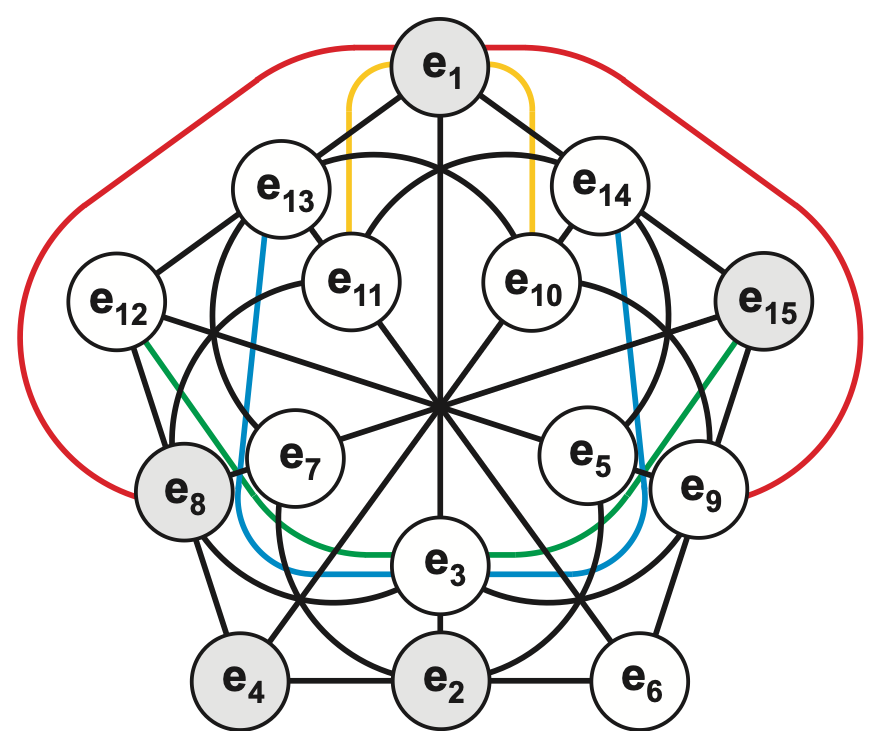
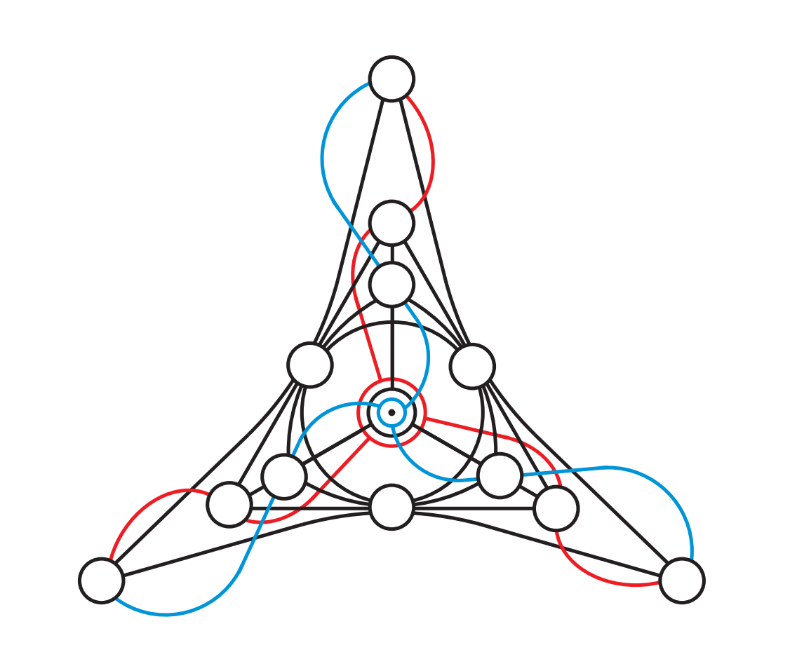

# Figures

Figures reproduced from published work, kept here so the documentation can refer to them.

## Source and licence

Both figures are from:

> M. Saniga, F. Holweck and P. Pracna, "From Cayley-Dickson Algebras to Combinatorial
> Grassmannians", *Mathematics* **3** (2015) 1192–1221,
> [doi:10.3390/math3041192](https://doi.org/10.3390/math3041192).

The article is open access under the Creative Commons Attribution licence
([CC BY 4.0](https://creativecommons.org/licenses/by/4.0/)). The figures are unmodified apart from
cropping. A preprint with the same figures is arXiv:1405.6888, "Cayley-Dickson Algebras and Finite
Geometry".

## Figure 5: PG(3,2) and the sedenion multiplication table

**What it shows.** The 15 imaginary sedenion units `e₁, …, e₁₅` are the 15 points of the projective
space PG(3,2). Three units lie on a common line exactly when the product of two of them is the
third, up to sign: `e_a · e_b = ± e_c`. There are 35 such lines, with 3 points on each line and 7
lines through each point, so the picture is also a Steiner triple system STS(15).

**How to read it.** The drawing is built around a pentagon.
- The 15 lines drawn in black (10 straight segments and 5 circular arcs) form the generalized
  quadrangle GQ(2,2).
- The other 20 lines come in four families of five. One line of each family is drawn in colour
  (yellow `{1, 10, 11}`, red `{1, 8, 9}`, blue `{3, 13, 14}`, green `{3, 12, 15}`); the other four
  of each family are its rotations through multiples of 72° about the centre and are not drawn.
- The five shaded points, `{1, 2, 4, 8, 15}`, are those through which every line is *ordinary*
  (see below).

**Ordinary and defective lines.** A line `{a, b, c}` with `a < b < c` is called ordinary if
`a + b = c` as integers and defective otherwise. Of the 35 lines, 25 are ordinary and 10 are
defective. The 10 defective lines, together with the 10 unshaded points, form a Desargues
configuration.

**In Kosmos.** The unit indices satisfy `e_a · e_b = ± e_(a XOR b)` in the Cayley-Dickson basis, so
the lines are the triples `{a, b, a XOR b}`. This figure belongs with `Sedenion<R>`.

## Figure 12: the (15₄, 20₃)-configuration inside PG(4,2)

**What it shows.** This is *not* a multiplication table of the sedenions, although it also has 15
points. It is a configuration of 15 points and 20 lines, with 4 lines through each point and 3
points on each line, that sits inside PG(4,2), the geometry of the 31 imaginary units of the
32-dimensional Cayley-Dickson algebra. Its points are 15 of those 31 units and its lines are 20 of
the 155 lines of PG(4,2): the defective lines of one particular type.

**How to read it.** The drawing has threefold symmetry.
- The centre is **three points**, not one: a larger red circle, a medium black circle and a smaller
  blue circle, drawn concentrically. Those three points form one of the 20 lines.
- The ten points and ten black lines other than the three long outer ones form a Desargues
  configuration, the same one that appears among the sedenions.
- Five points are added to it: the three outer corner points, and the red and blue points at the
  centre.
- Ten lines are added: the three red lines, the three blue lines, the three lines joining the corner
  points in pairs, and the line through the three central points.

**In Kosmos.** This figure belongs with the 32-dimensional work (the generic Cayley-Dickson
construction and its basis-unit loop), not with `Sedenion<R>`.
