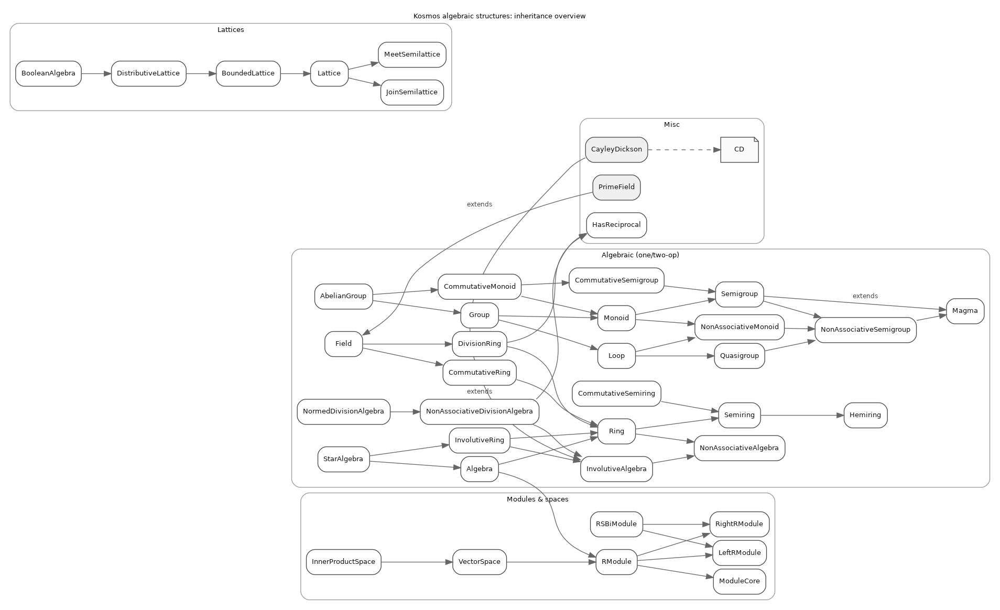

# Algebraic Structures

Here is a list of the algebraic structures currently supported by Kosmos and their
relationships. Each line is the top-level declaration as it appears in this package:

```kotlin
interface AbelianGroup<A : Any> : Group<A>, CommutativeMonoid<A>
interface AbelianHeap<H : Any> : Heap<H>
interface Algebra<R : Any, A : Any> : NonAssociativeAlgebra<R, A>, Semialgebra<R, A>, Ring<A>
interface BooleanAlgebra<A : Any> : DistributiveLattice<A>
interface BoundedLattice<A : Any> : Lattice<A>
interface CarlstromWheel<A : Any> : Wheel<A>
class CarrierTransport<A : Any, B : Any>
class CayleyDickson<A : Any> : NonAssociativeInvolutiveRing<CD<A>>
data class CD<A : Any>
interface CommutativeInvolutiveRing<A : Any> : CommutativeRing<A>, InvolutiveRing<A>
interface CommutativeMonoid<A : Any> : Monoid<A>, CommutativeSemigroup<A>
interface CommutativeRing<A : Any> : Ring<A>, CommutativeRng<A>, CommutativeSemiring<A>
interface CommutativeRng<A : Any> : Rng<A>
interface CommutativeSemigroup<A : Any> : Semigroup<A>
interface CommutativeSemiring<A : Any> : Semiring<A>
interface Dimensionality
interface DistributiveLattice<A : Any> : BoundedLattice<A>
interface DivisionRing<A : Any> : Ring<A>, HasReciprocal<A>
interface EuclideanDomain<A : Any, M : Any> : IntegralDomain<A>
interface EuclidMeasure<A : Any, M : Any>
data class ExtendedGcdResult<A : Any>
interface Field<A : Any> : DivisionRing<A>, CommutativeRing<A>
interface FiniteVectorSpace<F : Any, V : Any> : VectorSpace<F, V>, Dimensionality
interface Group<A : Any> : Monoid<A>, Loop<A>
interface HasCharacteristic
interface HasConj<A : Any>
interface HasFromBigInt<A : Any>
interface HasNormSq<A : Any, N : Any>
interface HasReciprocal<A : Any>
interface Heap<H : Any>
interface Hemiring<A : Any>
interface InnerProductSpace<F : Any, V : Any> : VectorSpace<F, V>
interface IntegralDomain<A : Any> : CommutativeRing<A>
interface InvolutiveRing<A : Any> : NonAssociativeInvolutiveRing<A>, Ring<A>
interface JoinSemilattice<A : Any>
interface Lattice<A : Any> : JoinSemilattice<A>, MeetSemilattice<A>
interface LeftRModule<R : Any, M : Any> : LeftRSemimodule<R, M>
interface LeftRSemimodule<R : Any, M : Any>
interface Loop<A : Any> : Quasigroup<A>, NonAssociativeMonoid<A>
interface Magma<A : Any>
interface Meadow<A : Any> : CommutativeRing<A>
interface MeetSemilattice<A : Any>
interface Monoid<A : Any> : Semigroup<A>, NonAssociativeMonoid<A>
interface NonAssociativeAlgebra<R : Any, A : Any> : RModule<R, A>, NonAssociativeRing<A>
interface NonAssociativeDivisionAlgebra<A : Any> : NonAssociativeInvolutiveRing<A>, HasReciprocal<A>
interface NonAssociativeInvolutiveRing<A : Any> : NonAssociativeRing<A>, HasConj<A>
interface NonAssociativeMonoid<A : Any> : Magma<A>
interface NonAssociativeRing<A : Any> : NonAssociativeRng<A>, HasFromBigInt<A>
interface NonAssociativeRng<A : Any>
interface NonAssociativeStarAlgebra<R : Any, A : Any> : NonAssociativeAlgebra<R, A>, NonAssociativeInvolutiveRing<A>
interface NormedDivisionAlgebra<N : Any, A : Any> : NonAssociativeDivisionAlgebra<A>, HasNormSq<A, N>
class PredicateSubgroup<A : Any> : Subgroup<A>
data class PrimeField : Field<BigInteger>, HasCharacteristic
interface Quasigroup<A : Any> : Magma<A>
interface RealNormedDivisionAlgebra<A : Any> : NormedDivisionAlgebra<Real, A>
interface RightRModule<M : Any, S : Any> : RightRSemimodule<M, S>
interface RightRSemimodule<M : Any, S : Any>
interface Ring<A : Any> : NonAssociativeRing<A>, Semiring<A>, Rng<A>
interface RModule<R : Any, M : Any> : LeftRModule<R, M>, RightRModule<M, R>, Semimodule<R, M>
interface Rng<A : Any> : Hemiring<A>, NonAssociativeRng<A>
interface RSBiModule<R : Any, M : Any, S : Any> : LeftRModule<R, M>, RightRModule<M, S>, RSBiSemimodule<R, M, S>
interface RSBiSemimodule<R : Any, M : Any, S : Any> : LeftRSemimodule<R, M>, RightRSemimodule<M, S>
interface Semialgebra<R : Any, A : Any> : Semimodule<R, A>, Semiring<A>
interface Semigroup<A : Any> : Magma<A>
interface Semimodule<R : Any, M : Any> : LeftRSemimodule<R, M>, RightRSemimodule<M, R>
interface Semiring<A : Any> : Hemiring<A>
interface StarAlgebra<R : Any, A : Any> : Algebra<R, A>, NonAssociativeStarAlgebra<R, A>, InvolutiveRing<A>
interface Subgroup<A : Any> : Group<A>
interface VectorSpace<F : Any, V : Any> : RModule<F, V>
interface Wheel<A : Any>
```

A few of these are not law-bearing structures but supporting pieces:
- `CD` and `CayleyDickson`: the Cayley-Dickson pair and doubling construction. Its factories are
  `usual` / `split` (any base), `associative` / `associativeSplit` (commutative base, typed as an
  associative `InvolutiveRing`), `commutative` (commutative base with the trivial involution, typed
  as a `CommutativeInvolutiveRing`) and `withSigma` (general `σ`).
- `CarrierTransport`: transports a structure along a wrapper or onto a substructure.
- `HasConj`, `HasNormSq`, `HasReciprocal`, `HasFromBigInt`, `HasCharacteristic`, `Dimensionality`:
  capability mixins. `HasReciprocal` documents the reciprocal contract that every field and division
  structure follows: `hasReciprocal` is the source of truth, and `reciprocal` throws
  `ArithmeticException` exactly where it returns `false`.

The hierarchy is captured by the following diagram:


To regenerate the graph after changing the hierarchy, see:
- [gen_structures_dot.py](../../../../../../../../../tools/gen_structures_dot.py)
